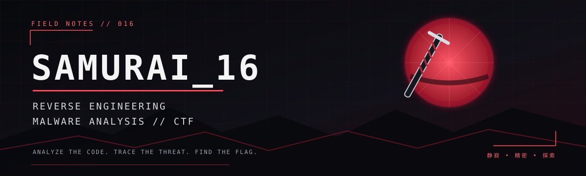

<!--
  SAMURAI_16 | Cybersecurity Portfolio
  Theme: dark / crimson / cyber-samurai
-->

  

  <h3>⚔️ Reverse Engineer&nbsp; • &nbsp;Malware Analyst&nbsp; • &nbsp;CTF Player</h3>

  

    
    
  

  
<i>Analyze the code. Trace the threat. Find the flag.</i>

---

## 🩸 About Me

I'm a cybersecurity enthusiast focused on understanding how software works beneath the surface.

- 🔬 **Reverse Engineering** — tracing program logic, inspecting binaries, and uncovering hidden behavior.
- 🦠 **Malware Analysis** — examining suspicious files and understanding their behavior.
- 🎯 **CTF Player** — especially interested in **Reverse Engineering** and **PWN** challenges.
- 🛠️ **Builder mindset** — learning by solving challenges, documenting findings, and creating practical tools.

> `Analyze everything. Trust nothing.`

## ⚔️ The Arsenal

**Reverse Engineering & Analysis**

**Debugging & Exploitation**

**Languages & Environments**

## 🎯 Current Missions

- Deepen my Reverse Engineering skills.
- Study packing, obfuscation, and anti-analysis techniques.
- Improve static and dynamic malware analysis workflows.
- Solve more advanced RE and PWN challenges.
- Build small tools that make security research more effective.

## 🏴‍☠️ CTF Battlefield

`REVERSE ENGINEERING` &nbsp; `PWN` &nbsp; `MALWARE ANALYSIS`

I enjoy breaking down a challenge, understanding the underlying mechanism, and writing clear notes about the solution.

## 📊 GitHub Intel

  
  

---

  <code>DISCIPLINE</code> &nbsp;•&nbsp; <code>PATIENCE</code> &nbsp;•&nbsp; <code>PRECISION</code>
    
  ⚔️ Walk the path. Keep reversing.

