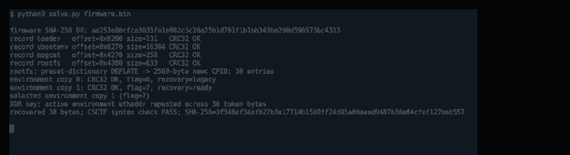

# CSCTF Reverse Engineering — Team Writeup

**Division:** `[DIVISION]`  
**Team name:** `[TEAM NAME]`  
**Team members / authors:** `[TEAM MEMBERS]`  
**Submission type:** `PARTICIPANT` (change to `WINNER` only if the team is confirmed in the top five)

This document covers the six Reverse Engineering challenges for which the available artifacts have been analyzed and the included local checks have passed. It is written as a single Markdown submission, with the detailed per-challenge sections retained in this file.

No live flags, recovered credentials, handshake nonces, derived session keys, cookies, tokens or live instance addresses are included. Challenge binaries and captures are treated as untrusted inputs; where the challenge permitted static analysis, the supplied executable was not launched.

## Challenge coverage

| Challenge | Main technique | Validation |
|---|---|---|
| Dawn Control Firmware Recovery | CRC-protected records, preset-dictionary DEFLATE, CPIO, redundant U-Boot environment, repeating-key XOR | Record and environment CRCs, recovered length and token-format checks |
| PoshTerm Hidden Service Code | PE and embedded JavaScript analysis, MD5 guards, Julian-date derivation, RC4 | Artifact hash, guard checks, date arithmetic, plaintext length and format |
| Carrier Shadow | ELF metadata, `.eh_frame_hdr`, canonical Huffman, xorshift32, raw DEFLATE | Descriptor checksum, extracted ELF hash and static marker checks |
| Operation Dawn — Lockbox | ELF initialization routine, rolling XOR, rotate/add inversion | 44-byte inverse and forward-transform equality; original ELF not executed |
| Meridian-Class CAU | Static x86-64 analysis, inverse XOR-shift and modular multiplication | All three 64-bit targets reproduced; 24-byte ASCII length checked |
| Split Horizon | .NET IL, PE static data, HMAC-derived frame key, TCP/PCAP reassembly, JSON parser differential | Eight commands decrypted; executed/logged coordinates distinguished; audit chain and signature verified |

---


---

## Dawn Control Firmware Recovery

**Artifact:** `firmware.bin` (1,048,576 bytes)  
**SHA-256:** `ae253e80cfca3035fe1e882c3c26a75b1d701f1b1bb343ba290d590573bc4313`

### 1. Objective

The supplied 1 MiB file is a compact recovery bundle for a DAWN-Control field radio. The useful data is stored in four CRC-protected records rather than in a conventional full-flash layout. The recovery token is stored in the root filesystem in an obfuscated form, and the init script explains how the device reconstructs it at boot.

The binary was treated as untrusted data. No firmware or extracted shell script was executed.

### 2. Identify the container

The first eight bytes are:

```text
44 57 46 57 01 00 04 00
```

This is the `DWFW` magic, version 1, followed by a record count of four. Each record-table entry is 20 bytes:

- 8-byte ASCII record name
- 32-bit little-endian file offset
- 32-bit little-endian byte length
- 32-bit little-endian CRC-32

The four records are:

| Record | Offset | Length | CRC-32 |
|---|---:|---:|---:|
| `loader` | `0x0200` | 111 | `e08559b1` |
| `ubootenv` | `0x0270` | 16,384 | `0e0748da` |
| `msgcat` | `0x4270` | 258 | `5a21c5b2` |
| `rootfs` | `0x4380` | 633 | `65047329` |

The solver checks the SHA-256 of the complete input, bounds-checks every record, and verifies all four CRC values before parsing any payload. This separates genuine container data from unused padding and catches incorrect offsets immediately.

### 3. Recover the root filesystem

The `rootfs` record begins with a zlib stream that requires a preset dictionary. The `msgcat` record is that dictionary: passing it to Python's `zlib.decompressobj(zdict=...)` successfully inflates the record into a 2,560-byte `newc` CPIO archive.

The archive contains ten entries, including:

- `etc/config/radio`
- `etc/init.d/S40admin`
- the normal init scripts and system banner

`etc/config/radio` stores `admin_token` as hexadecimal bytes. The important point is that the token is not meant to be used directly; the boot script describes the transformation that produces the runtime key.

### 4. Reconstruct the runtime key

The relevant part of `etc/init.d/S40admin` performs these operations:

1. Read `ethaddr` from the U-Boot environment and remove the colon separators.
2. Read `admin_token` from `etc/config/radio`.
3. Convert the token from hexadecimal into bytes, two hex characters at a time.
4. XOR each token byte with the corresponding byte of the MAC address, repeating the six-byte MAC as necessary.
5. Write the result to `/var/run/admin.key`.

This is a repeating-key XOR, not a cryptographic key derivation function. The script itself is the evidence for the operation and key source.

### 5. Select the correct U-Boot environment

The `ubootenv` record contains two 8 KiB redundant environment copies. Each copy has a little-endian CRC-32, a one-byte redundancy flag, and NUL-separated `key=value` entries.

Both copies pass their CRC checks, so selecting the first copy merely because it is valid would be insufficient. Their contents distinguish the stale and active states:

- Copy 0: flag `6`, `recovery=legacy`
- Copy 1: flag `7`, `recovery=ready`

The second copy is the recovery-ready environment. Its `ethaddr` is the value used by the init script, so the solver selects it rather than the legacy copy.

### 6. Reproducible recovery

Run the static solver with Python 3:

```bash
python3 solve.py firmware.bin
```

The script validates the outer SHA-256, all record CRCs, the dictionary-based decompression, the CPIO structure, both environment CRCs, and the active environment marker. It then applies the exact repeating-MAC XOR described by `S40admin`.

To print the recovered plaintext locally, use:

```bash
python3 solve.py firmware.bin --show
```

The default mode intentionally does not echo the recovered token into logs or screenshots.

### 7. Validation

The recovery is supported by independent checks at each layer:

- The input SHA-256 matches the challenge artifact.
- All four container records pass CRC-32.
- The preset-dictionary DEFLATE stream expands to exactly 2,560 bytes.
- The CPIO parser reaches `TRAILER!!!` and extracts the expected configuration and init script.
- Both U-Boot environment copies pass CRC-32, but only one has `recovery=ready`.
- The XOR result is 30 bytes and matches the required `CSCTF{...}` syntax.

No device boot, network interaction, or execution of firmware code was needed.

### 8. AI methodology

- **Tool/model:** ChatGPT GPT-6 was used as an analysis assistant to organize the static findings and help draft a reproducible parser. The binary transformations and final checks were independently implemented in Python.
- **Meaningful automation:** Python's standard library (`hashlib`, `struct`, `zlib`, `re`) validates the container, inflates the dictionary-compressed root filesystem, parses `newc` CPIO and U-Boot environment records, and reproduces the shell script's XOR operation.
- **Human checks:** The input hash and each CRC were compared against the artifact; the decompressed size and CPIO trailer were checked; both environment copies were independently CRC-checked; the active `recovery=ready` marker was confirmed before using its MAC.
- **Safety:** The firmware and extracted shell script were inspected as data. Neither was executed.

## PoshTerm Hidden Service Code

**Archive:** `chall.7z`  
**Archive SHA-256:** `a771296d0470a82a8d6080ba8967cb0b0cab589a31b0b6664e0722892dc27031`  
**Executable:** `PoshTerm.exe` (227,812,228 bytes)  
**Executable SHA-256:** `a20d559ea90c7f64241314863c4ee194f8dc1467d42eaf6211c43de7f530f135`

### 1. Objective and handling

The archive contains a Windows x64 terminal application and its user guide. The task is to recover the output of a hidden service command. The executable is a self-contained PE with a large embedded JavaScript bundle.

The executable was not launched. All inspection was performed against the archive contents and raw PE bytes.

### 2. Locate the hidden command

A static search for `service_code` locates the command registration inside the embedded JavaScript bundle (around file offset `0x62d3700`). The registration marks the command as hidden, so it is not part of the normal command listing.

The handler checks two MD5 conditions before invoking its asynchronous helper:

- The MD5 of the `POSHTERM_PROFILE` environment variable must match an embedded host constant.
- The MD5 of the final command argument must match the embedded code constant.

The handler compares the MD5 of `POSHTERM_PROFILE` with the embedded host digest `52d960bf972119685d50c3d33f737665`. The separate code-argument digest is:

```text
e3db766fd63bf1afdd34abcac1f5c112
```

This matches the MD5 of the exact UTF-8 string `Cessna 421 Golden Eagle`. The command parser also requires an equals sign before the argument. These checks explain why simply trying the obvious command or reading the visible decoy commands is not enough.

The application also registers visible decoy commands and decoy flag strings. Those are not used in the real service-code path.

### 3. Trace the service-code helper

The hidden handler calls an asynchronous helper that performs the following steps:

1. Search Wikipedia for the supplied aircraft name.
2. Fetch the selected article and locate the `first_flight` section.
3. Extract the date from the article text using a month/day/year pattern.
4. Normalize the date as `YYYY-MM-DD`.
5. Request a Julian date from the JPL `jd_cal` service using seven decimal places.
6. Convert the returned Julian-date string to UTF-8 bytes and use those bytes as the RC4 key.
7. Decrypt a 48-byte hexadecimal payload embedded directly in the JavaScript.

The embedded helper is important because it reveals the key derivation exactly. There is no need to guess passwords or brute-force the RC4 key.

### 4. Derive the key offline

The aircraft reference is `Cessna 421 Golden Eagle`. Its first-flight date is 14 October 1965. This date is independently corroborated by the aircraft history and a NASA technical report ([NASA NTRS](https://ntrs.nasa.gov/api/citations/19740023386/downloads/19740023386_Update.pdf); [Wikipedia article](https://en.wikipedia.org/wiki/Cessna_421_Golden_Eagle)). The Julian date at 00:00 UT for that date is:

```text
2439047.5000000
```

The application passes the string representation to RC4, so the key is the ASCII byte sequence for `2439047.5000000`, not an integer or floating-point binary representation. The corresponding JPL endpoint used by the application is `https://ssd-api.jpl.nasa.gov/jd_cal.api?format=jd.7&cd=1965-10-14`.

The ciphertext embedded in the JavaScript is:

```text
37f1f43867e61d207c0b78ca4385ee14
f67d98e0c0cdbe6e5027ff506e302cb6
6b8c8c5ad07d726c0e24e9f13bbcdfa9
```

The `j()` helper is a conventional RC4 implementation: it initializes the 256-byte permutation, performs the key-scheduling algorithm, then generates the keystream with the PRGA and XORs it with the ciphertext.

### 5. Why the environment guard does not block static recovery

The environment check controls whether the hidden command can be invoked through the application's shell. It is not part of the cryptographic transformation itself. The helper contains the complete ciphertext and the RC4 routine, and the date-to-key process is explicit.

Therefore the service output can be reproduced offline without setting `POSHTERM_PROFILE`, satisfying the command dispatcher, or executing the PE. The solver checks the embedded command markers and the known MD5 for the aircraft argument, computes the Julian date locally, and performs the same RC4 operation.

### 6. Reproducible solver

With the extracted `PoshTerm.exe` in the current directory:

```bash
python3 solve.py PoshTerm.exe
```

The solver checks the executable SHA-256, confirms that the hidden command and helper markers are present, verifies the aircraft argument's MD5, computes the Julian date, and runs RC4. It reports the recovered plaintext length, syntax check and SHA-256 without echoing the plaintext by default.

To display the recovered value locally:

```bash
python3 solve.py PoshTerm.exe --show
```

### 7. Validation

- The 7z archive and extracted PE hashes were checked against the supplied artifacts / prior extraction record.
- The hidden `service_code` registration, environment-variable guard, MD5 helper and `first_flight` lookup were found in the PE's embedded JavaScript.
- The aircraft string's MD5 matches the constant in the handler.
- The date calculation independently produces the seven-decimal Julian-date string used by the application.
- RC4 decrypts the exact embedded 48-byte payload into a 48-byte string matching the challenge's flag syntax.
- The Windows executable was never run.

### 8. AI methodology

- **Tool/model:** ChatGPT GPT-6 assisted with static code interpretation and the writeup structure. The executable was inspected as raw data; no AI-generated output was accepted without byte-level checks.
- **Meaningful automation:** Python was used to search PE bytes for embedded JavaScript markers, verify hashes and the MD5 gate, calculate the Julian date, and reproduce RC4.
- **Human checks:** The hidden handler and RC4 implementation were read directly from the embedded bundle; the MD5 of the aircraft string was independently calculated; the Julian date was independently derived; and the ciphertext length and decrypted syntax were checked.
- **Safety:** The PE was not executed, and the service helper's network calls were not invoked. The output was reconstructed locally from the embedded algorithm and data.

## Carrier Shadow: Second-Stage Extraction

**Input:** `carrier-shadow` (1,337,736 bytes)  
**Input SHA-256:** `995fd7161d984898e521eb581f93380b11f31e3de342b368519a2221fb192a04`  
**Extracted stage:** `carrier-stage2.elf` (34,192 bytes)  
**Stage SHA-256:** `4f864208546b2108ae453292220e297684fe6bb74384e380c95dd9b4b33b06b9`

### 1. Objective and safety boundary

The challenge provides a stripped x86-64 ELF and asks for a hidden second-stage payload to be found and extracted statically. The payload is not required to be run. We treated both ELF files as untrusted data and did not execute either one.

### 2. ELF layout and the unusual data source

`readelf -S` shows that the input has a large `.eh_frame_hdr` section:

```text
.eh_frame_hdr  file offset 0x9b600  size 0x3078c
.data.rel.ro   file offset 0x145810
```

The `.eh_frame_hdr` contains a sorted function-address table. In this sample, the payload is encoded in the differences between adjacent table entries. A decoder routine in `.text` (near virtual address `0x995e0`) interprets selected differences as a compact descriptor and then decodes the following difference stream.

This is not ordinary code disassembly: the function-address metadata itself is the carrier for the hidden byte stream.

### 3. Find the embedded payload descriptor

The extraction logic identifies an eight-gap signature at difference index 123. The 16 relevant differences are:

```text
69 75 80 91 47 58 35 37 02 71 71 02 02 118 62 16
```

The descriptor fields are encoded as small differences with an offset of two:

- `selector = D[123 + 8] - 2`, which selects table 0.
- The next four adjusted differences encode the decoded stream length in little-endian order: 17,733 bytes.
- The following adjusted difference is an XOR check byte (`0x74`).

The selected Huffman code-length table is reached through the pointer table at file offset `0x145810`.

### 4. Reverse the canonical Huffman stream

The selected table contains 256 code lengths, one per possible byte value. The solver reconstructs the canonical Huffman codes from the length histogram, then maps each encoded symbol (the function-address delta minus two) back to its codeword.

The codewords are consumed most-significant bit first and assembled into bytes until the descriptor's 17,733-byte length is reached. The XOR of those bytes must equal `0x74`; this acts as a consistency check for the descriptor and decode loop.

### 5. Remove the keystream and decompress

The encoded stream is XORed with a 32-bit xorshift keystream. Its initial state is `0x6a2b3c4d`; each output byte uses the low byte of the updated state. The result is a raw DEFLATE stream, so it is decompressed with a negative `wbits` value rather than expecting a zlib wrapper.

The decompressed result is a 34,192-byte ELF. Its SHA-256 matches the separately recovered stage artifact, providing a strong end-to-end check that the Huffman decode, XOR stream and DEFLATE step were all correct.

### 6. Inspect the stage without executing it

The extracted file has a valid ELF64 header. Static inspection finds:

- A flag-format string at file offset `0x7070`.
- The adjacent label `payload: operation-dawn authorization` beginning at file offset `0x7098`.

The label ties the embedded string to the intended authorization payload. No entry point was invoked and no second-stage code was run.

### 7. Reproducible extraction

Place `carrier-shadow` beside `solve.py` and run:

```bash
python3 solve.py carrier-shadow -o carrier-stage2.elf
```

The script checks the original SHA-256, reads the `.eh_frame_hdr`-backed table, locates the descriptor, rebuilds the canonical Huffman codes, verifies the XOR checksum, reverses the xorshift stream, decompresses raw DEFLATE, and verifies the second-stage SHA-256. It then reports the marker offsets without printing the recovered flag.

For local inspection only, `--show` prints the extracted flag-format string:

```bash
python3 solve.py carrier-shadow -o carrier-stage2.elf --show
```

### 8. Validation

- Input SHA-256 matches the challenge artifact.
- The descriptor at difference index 123 yields selector 0, length 17,733 and XOR byte `0x74`.
- Canonical Huffman output has the expected length and passes the XOR check.
- Raw DEFLATE expands to an ELF64 file of exactly 34,192 bytes.
- The extracted ELF SHA-256 matches the independent stage artifact.
- The authorization marker and flag-format string are present at the expected offsets.
- Neither the original ELF nor the extracted payload was executed.

### 9. AI methodology

- **Tool/model:** ChatGPT GPT-6 helped interpret the static ELF metadata and organize the reverse-engineering steps. The extraction was implemented and checked in a standalone Python script.
- **Meaningful automation:** `readelf` was used to map sections; Python (`struct`, `collections.Counter`, `zlib`, `hashlib`) decoded the address deltas, canonical Huffman stream, xorshift mask and raw DEFLATE payload.
- **Human checks:** The input hash, section offsets, descriptor bytes, decoded length, XOR check, ELF magic and extracted-stage hash were checked independently. The second stage was inspected as data only.
- **Safety:** No loader, shellcode or extracted ELF code was executed.

## Operation Dawn, Annex Entry 06: Lockbox

**Artifact:** `lockbox` — Linux x86-64 ELF  
**SHA-256:** `f4e6bc8ccbcef3908467a41941fbc7f561adab7e45a2bbfa61c7b78c07c724c4`

### 1. Objective and handling

The field unit accepts a 44-byte passphrase, but the executable does not reveal it. The goal is to recover the accepted input from the validator's static data and transformation.

The ELF was inspected as untrusted data. The supplied executable was not launched during this analysis; the recovered input was validated by reproducing the validator's forward transformation in Python.

### 2. Separate the decoy from the real check

A first pass with `strings -a -t x lockbox` reveals the gate messages and an encoded-looking phrase:

```text
open: supply a pass phrase
GATE: pass phrase accepted - crossing open
GATE: pass phrase refused - crossing barred
the quartermaster laughs - that is last week's code, soldier
4+>5{(>(:6>{:5?{625?{/3>{/)2+,2)>
```

The visible encoded phrase belongs to a decoy path in the normal command handler. The actual passphrase check is performed earlier, from an ELF initialization routine.

### 3. Locate the pre-main validator

Inspect `.init_array` and disassemble the ELF:

```bash
readelf -x .init_array lockbox
objdump -d -M intel lockbox
```

The initialization entry at `0x10e0` validates the supplied command-line arguments before the ordinary command handler at `0x11c0` runs.

The routine checks that the command is `open`, trims the supplied phrase, and requires a length of `0x2c` bytes. It then transforms the input byte-by-byte and compares each result with a 44-byte target array. A successful comparison sets the gate-state value later checked by the normal handler.

This explains why following only the obvious `main()` command path leads to the decoy.

### 4. Reconstruct the byte transformation

The validator's loop performs these operations on each byte:

```text
value = plaintext[i] XOR state
value = ROL8(value, rotation)
value = (value + key[i mod 8]) mod 256
compare value with target[i]
state = (state + i + value) mod 256
rotation = rotation + 3
```

The initial state is `0x5b`, the initial rotation is `1`, and the 8-byte key is stored in `.rodata`. The rotation is applied modulo eight by the 8-bit rotate instruction.

The transformation is reversible because each operation has a direct inverse:

- Subtract the corresponding key byte modulo 256.
- Rotate right by the same count.
- XOR with the current state.

The state for the next byte is updated from the current index and the encrypted byte. No brute force is needed.

### 5. Recover and independently validate the input

The included `solve.py` reverses the 44 target bytes. It then applies the original forward transformation to the recovered bytes and asserts that every output byte matches the target array.

Run:

```bash
python3 solve.py
```

The default mode reports only validation results. To display the recovered phrase locally, use:

```bash
python3 solve.py --show
```

The solver checks the exact length, the expected flag wrapper syntax, and the complete forward-transform equality. It does not execute the ELF.

### 6. Validation

The following checks passed:

- The supplied artifact hash matches the recorded SHA-256.
- Static analysis identifies the pre-main validator and the 44-byte length check.
- The recovered input has exactly 44 bytes.
- The Python forward transformation reproduces all 44 target bytes.
- The recovered bytes satisfy the expected `CSCTF{...}` wrapper.
- The decoy phrase is not used as the accepted passphrase.

The result is therefore supported by a byte-for-byte inverse and forward check, rather than by a guessed phrase or an execution of the untrusted binary.

---

## Meridian-Class Command-Authentication Unit Recovery

**Artifact:** `cau_verify` — Linux x86-64 ELF, 682,600 bytes  
**SHA-256:** `19fc211ceda00357c70c5039dd882f11491c8bfb092b15824bc13f2bdc84990c`

### 1. Objective and safety

The verifier accepts one 24-byte recovery key. The binary is self-contained, and the challenge explicitly allows static analysis. The supplied ELF was treated as untrusted data and was not executed.

The validator divides the input into three consecutive 8-byte blocks. Each block is processed by the same 64-bit mixing function and compared with one hard-coded 64-bit target.

### 2. Locate the validator and input constraints

Identify the artifact and inspect its headers:

```bash
file cau_verify
sha256sum cau_verify
readelf -h cau_verify
readelf -S cau_verify
```

The entry point transfers control to the main validation routine at `0x4014f0`. Static disassembly shows that the routine requires exactly one argument and checks that its length is `0x18` bytes.

The validator reads three little-endian 64-bit words at offsets `0`, `8`, and `16`. Each word is checked independently.

### 3. Reconstruct the mixing function

The same sequence of operations is applied to every block:

```text
x ^= x >> 33
x = x * A mod 2^64
x ^= x >> 33
x = x * B mod 2^64
x ^= x >> 33
```

The multipliers are odd:

```text
A = 0x9df50ad53e8f1c7b
B = 0xc17a4b92d6e30f55
```

The validator compares the three results against constants embedded in the executable:

| Input block | Target |
|---|---|
| bytes 0–7 | `0xd8dba78e270f595d` |
| bytes 8–15 | `0x25d4e9834acb3349` |
| bytes 16–23 | `0x976a0bc7e24f7338` |

All arithmetic is unsigned 64-bit arithmetic, so multiplication wraps modulo `2^64`.

### 4. Why the function is invertible

The operation `x ^= x >> 33` is self-inverse for 64-bit values. Applying it twice cancels the shifted contribution because shifting by 66 bits leaves no bits.

Both multipliers are odd, so each has a multiplicative inverse modulo `2^64`. Python calculates those inverses with:

```python
pow(A, -1, 1 << 64)
pow(B, -1, 1 << 64)
```

The inverse therefore applies the operations in reverse order:

1. Undo the final XOR-shift.
2. Multiply by the modular inverse of `B`.
3. Undo the middle XOR-shift.
4. Multiply by the modular inverse of `A`.
5. Undo the first XOR-shift.

This recovers each original 64-bit word exactly. The three recovered words are converted back to little-endian bytes and concatenated.

### 5. Reproducible solver

Run the verification-only mode:

```bash
python3 solve.py
```

The solver inverts all three targets, re-applies the original forward function to each recovered block, and checks the total input length and ASCII encoding. It does not print the recovery key by default.

To display the recovered value locally:

```bash
python3 solve.py --show
```

### 6. Validation

- The artifact SHA-256 matches the challenge-provided digest.
- The disassembly confirms the 24-byte length check and the three block offsets.
- Each recovered 64-bit block reproduces its corresponding embedded target under the original forward function.
- The concatenated result is exactly 24 ASCII bytes.
- No executable code from the supplied ELF was run.

---

## Split Horizon: Vireo Command/Audit Parser Differential

**Platform:** TL-9 Vireo command and audit pipeline  
**Primary artifacts:** `session.pcap`, `vireo-ctl.dll`, `command-server.go`, `manifest.json`, `audit.log`

### 1. Objective and safety

The incident report says the drone diverged from its approved route while the ground command server recorded a nominal sortie. The task is to determine the waypoint the flight-control client actually used.

The PCAP, .NET assembly and Go source were analyzed as data. The supplied DLL was not executed, and the analysis does not contact a live service.

### 2. Reconstruct the uplink stream

The capture is a classic Ethernet PCAP containing the transfer of the client assembly and a separate TCP command session. The command protocol uses a five-byte frame header:

```text
'V' 'W' | frame_type | payload_length (big-endian, 16-bit)
```

The client sends a type-1 frame containing a 16-byte nonce. The server replies with its own type-1 nonce, followed by encrypted type-2 command frames. Type-3 frames are telemetry and are not passed to the command parser in the client loop.

The solver reassembles the two TCP directions, parses the frame boundaries and extracts the two handshake nonces. It does not print either nonce or the derived session key.

### 3. Recover the session-key derivation from the .NET client

The relevant methods are in `Vireo.Uplink.Protocol`:

- `SharedSecret()` creates a byte array by XORing the two 32-byte static masks.
- `DeriveSessionKey(clientNonce, serverNonce)` concatenates the nonces, computes HMAC-SHA256 using that shared secret, and copies the first 16 digest bytes.
- `Mask(payload, sessionKey)` XORs each payload byte with the repeating 16-byte session key.

The protocol static constructor loads the two mask arrays from PE `FieldRVA` data. The solver maps those RVAs through the PE section table and reconstructs the shared secret without launching the assembly.

The command loop applies `Mask` to each type-2 payload before passing it to `CommandCodec.Parse`.

### 4. Identify the parser mismatch

The client calls `JsonSerializer.Deserialize<CommandEnvelope>(json, Options)`. Its static constructor creates a default `JsonSerializerOptions` object and does not enable case-insensitive property matching. The client therefore uses exact, case-sensitive JSON property-name matching.

The supplied Go server source documents the opposite behavior for `encoding/json`:

- JSON object keys are matched to struct fields case-insensitively.
- When multiple keys match the same field, the later value overwrites the earlier one.

This creates a parser differential when one command contains two spellings of the same field that differ only by case.

### 5. Recover the divergent waypoint

After deriving the session key and decrypting the type-2 frames, eight command messages are recovered. Sequence 1 contains both lower-case and upper-case spellings of the latitude and longitude fields:

```json
{
  "waypoint_lat": 47.3566,
  "waypoint_lon": 18.5182,
  "WAYPOINT_LAT": 47.3548,
  "WAYPOINT_LON": 18.5226
}
```

The client accepts the exact lower-case property names and ignores the case-variant spellings. It therefore sends the drone to:

```text
47.3566, 18.5182
```

The Go server matches both spellings case-insensitively and applies the later values. Its audit record therefore reflects:

```text
47.3548, 18.5226
```

The approved waypoint in `manifest.json` is `47.3555, 18.5234`, with a server tolerance of `0.001` degrees. The logged point is inside that tolerance, while the executed point is outside it. The executed point is approximately 410 metres from the approved waypoint, consistent with the incident note.

The exploited fields are `waypoint_lat+waypoint_lon`; the parser behavior is `case_sensitive_exact_vs_case_insensitive_last_wins`.

### 6. Validate the audit evidence

The solver independently recomputes all eight audit-entry hashes using the formula in `command-server.go`. Every `prev_hash` and `entry_hash` matches, and the final chain root matches the summary.

The Ed25519 signature over the chain root also verifies against the public key in the manifest. This confirms that the audit trail is intact; it does not make the server's parsed coordinates equivalent to the coordinates used by the client.

### 7. Reproduce the analysis

Place the supplied files beside `solve.py`, then run:

```bash
python3 solve.py \
  --pcap session.pcap \
  --dll vireo-ctl.dll \
  --manifest manifest.json \
  --audit audit.log
```

The script uses Python's standard library for PCAP parsing, TCP reassembly, frame parsing, HMAC-SHA256, XOR decoding and audit-chain verification. If the `cryptography` package is installed, it also verifies the Ed25519 signature. It prints the two parsed waypoints and validation results, but never prints the derived session key or handshake nonces.

### 8. Validation

- The PCAP contains a complete client/server handshake and eight type-2 command frames.
- The client protocol methods in the .NET IL establish the key derivation and repeating-XOR mask.
- The decrypted commands reproduce the sequence-1 case-variant duplicate fields.
- Exact-case client parsing yields the executed waypoint; Go-style case-insensitive last-wins parsing yields the audited waypoint.
- The logged waypoint passes the manifest tolerance; the executed waypoint does not.
- All eight audit entries, the chain root and the Ed25519 signature verify.

---

## AI-assisted methodology

**Tool/model:** ChatGPT GPT-6 was used as an analysis assistant and drafting aid. It helped interpret disassembly and IL, identify data structures and transformations, and organize the explanations. It did not replace the checks against the supplied artifacts.

**Meaningful use and automation:**
- Python scripts automate deterministic parsing and validation: record extraction and checksums, PE/ELF metadata inspection, byte-transform inversion, PCAP/TCP reassembly, frame decryption, and audit-chain verification.
- The solvers are reproducible and default to verification-only output. They do not print recovered flags, keys or ephemeral session material unless a local `--show` option is explicitly requested.
- No raw chat exports are included. The report contains only the relevant technical reasoning and reproducible commands.

**Human checks:**
- Artifact sizes and SHA-256 digests were checked against the challenge materials.
- The important constants, instruction order, state updates, byte order and length constraints were checked against the actual disassembly or IL.
- Each solver's inverse result was checked by re-running the original forward transformation or by independently checking the recovered structure.
- For Split Horizon, the JSON parsing behavior was checked against both the supplied Go source and the client .NET IL; the audit hash chain and Ed25519 signature were independently verified.
- The untrusted ELF/DLL artifacts were not executed for the static-only challenges.

### Workflow screenshots

The following are genuine terminal screenshots captured from actual local solver runs. They show representative firmware recovery, arithmetic inversion and encrypted-PCAP/audit validation workflows.





