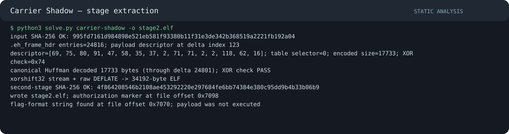

# CSCTF Reverse Engineering — Carrier Shadow: Second-Stage Extraction

**Division:** `[DIVISION]`  
**Team:** `[TEAM NAME]`  
**Authors:** `[TEAM MEMBERS]`  
**Category:** Reverse Engineering  
**Input:** `carrier-shadow` (1,337,736 bytes)  
**Input SHA-256:** `995fd7161d984898e521eb581f93380b11f31e3de342b368519a2221fb192a04`  
**Extracted stage:** `carrier-stage2.elf` (34,192 bytes)  
**Stage SHA-256:** `4f864208546b2108ae453292220e297684fe6bb74384e380c95dd9b4b33b06b9`

## 1. Objective and safety boundary

The challenge provides a stripped x86-64 ELF and asks for a hidden second-stage payload to be found and extracted statically. The payload is not required to be run. We treated both ELF files as untrusted data and did not execute either one.

## 2. ELF layout and the unusual data source

`readelf -S` shows that the input has a large `.eh_frame_hdr` section:

```text
.eh_frame_hdr  file offset 0x9b600  size 0x3078c
.data.rel.ro   file offset 0x145810
```

The `.eh_frame_hdr` contains a sorted function-address table. In this sample, the payload is encoded in the differences between adjacent table entries. A decoder routine in `.text` (near virtual address `0x995e0`) interprets selected differences as a compact descriptor and then decodes the following difference stream.

This is not ordinary code disassembly: the function-address metadata itself is the carrier for the hidden byte stream.

## 3. Find the embedded payload descriptor

The extraction logic identifies an eight-gap signature at difference index 123. The 16 relevant differences are:

```text
69 75 80 91 47 58 35 37 02 71 71 02 02 118 62 16
```

The descriptor fields are encoded as small differences with an offset of two:

- `selector = D[123 + 8] - 2`, which selects table 0.
- The next four adjusted differences encode the decoded stream length in little-endian order: 17,733 bytes.
- The following adjusted difference is an XOR check byte (`0x74`).

The selected Huffman code-length table is reached through the pointer table at file offset `0x145810`.

## 4. Reverse the canonical Huffman stream

The selected table contains 256 code lengths, one per possible byte value. The solver reconstructs the canonical Huffman codes from the length histogram, then maps each encoded symbol (the function-address delta minus two) back to its codeword.

The codewords are consumed most-significant bit first and assembled into bytes until the descriptor's 17,733-byte length is reached. The XOR of those bytes must equal `0x74`; this acts as a consistency check for the descriptor and decode loop.

## 5. Remove the keystream and decompress

The encoded stream is XORed with a 32-bit xorshift keystream. Its initial state is `0x6a2b3c4d`; each output byte uses the low byte of the updated state. The result is a raw DEFLATE stream, so it is decompressed with a negative `wbits` value rather than expecting a zlib wrapper.

The decompressed result is a 34,192-byte ELF. Its SHA-256 matches the separately recovered stage artifact, providing a strong end-to-end check that the Huffman decode, XOR stream and DEFLATE step were all correct.

## 6. Inspect the stage without executing it

The extracted file has a valid ELF64 header. Static inspection finds:

- A flag-format string at file offset `0x7070`.
- The adjacent label `payload: operation-dawn authorization` beginning at file offset `0x7098`.

The label ties the embedded string to the intended authorization payload. No entry point was invoked and no second-stage code was run.

## 7. Reproducible extraction

Place `carrier-shadow` beside `solve.py` and run:

```bash
python3 solve.py carrier-shadow -o carrier-stage2.elf
```

The script checks the original SHA-256, reads the `.eh_frame_hdr`-backed table, locates the descriptor, rebuilds the canonical Huffman codes, verifies the XOR checksum, reverses the xorshift stream, decompresses raw DEFLATE, and verifies the second-stage SHA-256. It then reports the marker offsets without printing the recovered flag.

For local inspection only, `--show` prints the extracted flag-format string:

```bash
python3 solve.py carrier-shadow -o carrier-stage2.elf --show
```

## 8. Validation

- Input SHA-256 matches the challenge artifact.
- The descriptor at difference index 123 yields selector 0, length 17,733 and XOR byte `0x74`.
- Canonical Huffman output has the expected length and passes the XOR check.
- Raw DEFLATE expands to an ELF64 file of exactly 34,192 bytes.
- The extracted ELF SHA-256 matches the independent stage artifact.
- The authorization marker and flag-format string are present at the expected offsets.
- Neither the original ELF nor the extracted payload was executed.

## 9. AI methodology

- **Tool/model:** ChatGPT GPT-6 helped interpret the static ELF metadata and organize the reverse-engineering steps. The extraction was implemented and checked in a standalone Python script.
- **Meaningful automation:** `readelf` was used to map sections; Python (`struct`, `collections.Counter`, `zlib`, `hashlib`) decoded the address deltas, canonical Huffman stream, xorshift mask and raw DEFLATE payload.
- **Human checks:** The input hash, section offsets, descriptor bytes, decoded length, XOR check, ELF magic and extracted-stage hash were checked independently. The second stage was inspected as data only.
- **Safety:** No loader, shellcode or extracted ELF code was executed.

### Workflow evidence


