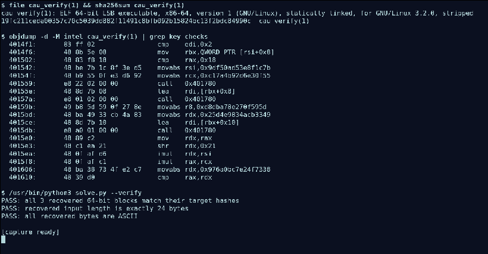

# CSCTF Writeup — Meridian-Class Command-Authentication Unit

> **Team:** `[TEAM NAME]`  
> **Division:** `[DIVISION]`  
> **Challenge:** Meridian-class CAU recovery key  
> **Category:** Reverse Engineering  
> **Artifact:** `cau_verify` (Linux x86-64 ELF)  
> **Artifact SHA-256:** `19fc211ceda00357c70c5039dd882f11491c8bfb092b15824bc13f2bdc84990c`  
> **Artifact size:** `682,600` bytes

## Summary

The CAU verifier accepts one command-line argument of exactly 24 bytes. The argument is split into three consecutive 8-byte blocks. Each block is passed through the same reversible 64-bit mixing function and compared with a hard-coded 64-bit target.

The function is not encryption: it is a composition of invertible operations over 64-bit integers. Both multiplication constants are odd, so each has a modular inverse modulo (2^{64}). The right-xor-shift operation is also reversible. Reversing those operations recovers each original 8-byte block independently.

The included `solve.py` implements the inverse, checks each recovered block by applying the original forward transform, and verifies that the joined result is exactly 24 ASCII bytes.

## 1. Artifact triage and safety

The supplied file was inspected without executing it.

```bash
file cau_verify
sha256sum cau_verify
readelf -h cau_verify
readelf -S cau_verify
```

The file is a stripped, statically linked, little-endian ELF64 executable for x86-64. Its entry point is `0x401650`. The computed SHA-256 matches the value in the challenge description.

The verifier is self-contained, so static disassembly is sufficient. No live instance, network endpoint, credentials, or external service is involved. The original ELF was not run.

## 2. Locate the validation routine

The startup code at `0x401650` passes `0x4014f0` as the program's main routine. Inspecting that function with:

```bash
objdump -d -M intel cau_verify
```

reveals the input constraints near the beginning:

```asm
4014f1: cmp    edi,0x2
4014f4: jne    0x401508
4014f6: mov    rbx,QWORD PTR [rsi+0x8]
4014fa: mov    rdi,rbx
4014fd: call   0x4010c8
401502: cmp    rax,0x18
401506: je     0x401542
```

The routine requires exactly one user-supplied argument (`argc == 2`) and checks that its length is `0x18`, or 24 bytes. It then reads three 64-bit words from offsets `0`, `8`, and `16` of the argument.

The helper at `0x401780` loads a 64-bit word from the address passed in `rdi`. The calls at the relevant points in the validator read the three consecutive blocks.

## 3. Recover the validation function

The validator loads two 64-bit multipliers:

```text
A = 0x9df50ad53e8f1c7b
B = 0xc17a4b92d6e30f55
```

For each input block, the instructions perform the following operations in 64-bit arithmetic:

```text
x ^= x >> 33
x *= A
x ^= x >> 33
x *= B
x ^= x >> 33
```

The multiplication results are truncated modulo (2^{64}). The final value is compared against one of three constants, one for each 8-byte block:

| Input offset | Comparison constant |
|---:|---:|
| `0` | `0xd8dba78e270f595d` |
| `8` | `0x25d4e9834acb3349` |
| `16` | `0x976a0bc7e24f7338` |

The disassembly shows these constants being loaded immediately before the comparisons. The relevant instructions also show the reads from `rbx`, `rbx+8`, and `rbx+0x10`.

## 4. Why the function can be inverted

Let:

[
X(x) = x oplus (x gg 33)
]

The first and last operations are right-xor-shifts. For a 64-bit value, this particular transform is self-inverse:

[
X^{-1}(y) = y oplus (y gg 33)
]

Applying the shift a second time contributes nothing because (2 cdot 33 geq 64).

The two multipliers are odd. An odd integer is coprime to (2^{64}), so it has a modular multiplicative inverse modulo (2^{64}). Python can calculate these inverses with:

```python
pow(A, -1, 1 << 64)
pow(B, -1, 1 << 64)
```

The forward function is:

[
H(x) = Xleft(B cdot Xleft(A cdot X(x)
ight)
ight)
pmod {2^{64}}
]

To recover the input from a target hash (y), undo the operations in reverse order:

1. Apply (X^{-1}).
2. Multiply by (B^{-1} pmod {2^{64}}).
3. Apply (X^{-1}) again.
4. Multiply by (A^{-1} pmod {2^{64}}).
5. Apply (X^{-1}) one final time.

This recovers the original 64-bit word exactly. No brute force is required.

## 5. Solver

Run the included solver with Python 3:

```bash
python3 solve.py
```

It inverts each of the three comparison constants independently, converts each recovered integer back to little-endian bytes, and concatenates the blocks in input order.

For a validation-only run that does not print the recovered key:

```bash
python3 solve.py --verify
```

The `--verify` mode checks all three blocks by running the recovered values through the original forward hash function. It also checks the total length and ASCII encoding.

## 6. Validation and result handling

The following checks were performed in the analysis workflow:

- The local file's SHA-256 matches the challenge-provided digest.
- The argument-length check in the disassembly is exactly 24 bytes.
- The three comparison constants were mapped to the three 8-byte input offsets in order.
- The inverse was checked by applying the forward transform to each recovered block and comparing it with its corresponding embedded constant.
- The joined result is exactly 24 bytes and decodes as ASCII.
- The original executable was not run; validation was performed in the Python reimplementation.

The recovered value is intentionally not printed in this writeup, in keeping with the event instruction not to include live flags in the submission. The solver can reproduce it locally.

## 7. AI-assisted methodology

**Tool/model:** ChatGPT (GPT-6).

**Meaningful AI contribution:** AI assistance was used to organize the static-analysis workflow, interpret the relevant x86-64 instructions, derive the inverse of the 64-bit mixing routine, and draft the Python solver. The solver automates the three block inversions and the forward-hash assertions.

**Checks and analyst oversight:** The analysis was restricted to the supplied local artifact. The artifact digest, argument length, block offsets, immediate constants, byte order, and forward-transform assertions were checked against the file and disassembly. No live target was contacted and no credentials, tokens, cookies, instance URLs, or chat exports were used.

**Limitations:** The solver's assertions provide reproducible computational validation. A team member should review the disassembly excerpts and solver before submission and ensure the team/division fields above are correct. This writeup does not claim an independent review by another team member.

**Workflow screenshot:** The attached terminal capture documents file identification and digest verification, the relevant validator disassembly and constants, and the solver's verification-only output. It shows actual commands and outputs from this static-analysis workflow.


